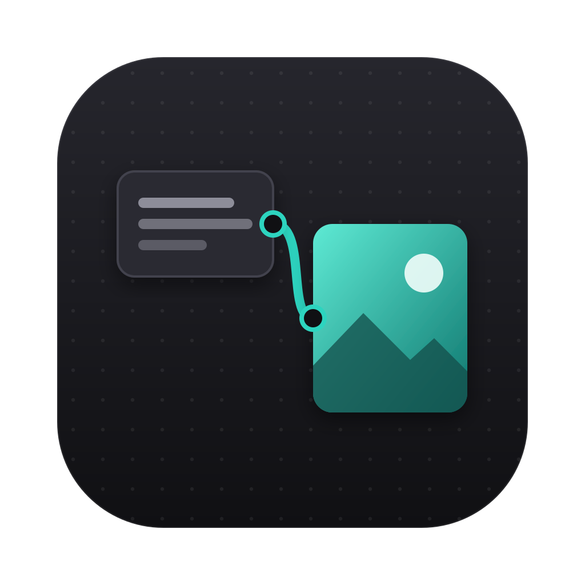

<p align="center">
  
</p>

<h1 align="center">画布</h1>

<p align="center">
  在一张无限画布上生成图片：写一段提示词，拉一根线，出图。<br>
  本地运行 · 用你自己的 API Key · 图片和项目只存在你自己的电脑上
</p>

<p align="center"><sub>A local-first, node-based infinite canvas for AI image generation — text-to-image and image-to-image, bring your own API key, packable as a Mac app.</sub></p>

---

提示词、参考图、每一版结果，都摆在同一张画布上，用连线标出「这张图是从哪来的」。想换个说法、换张参考图再试一版，直接从上一张接着连。整个创作过程摊开在眼前，不会淹没在一长串对话记录里。

## 亮点

- **节点式工作流**：文本节点写提示词，图片节点出图；把图片连到下一个图片节点就是图生图，可以一路接着迭代
- **一次多张，平铺挑图**：一次出 1 / 2 / 4 张或任意张数，叠在同一个节点里左右切换；一键「平铺」排成一排对比，大图预览用方向键翻看
- **参考图随手放**：拖进画布、⌘V 粘贴截图、点按钮上传都可以；多张参考图自动编号成 图1、图2…，拖动就能调整顺序
- **参数一次选完**：比例、清晰度、画质、背景、格式、张数按所选模型自动出现，放在同一个弹层里，不用来回点
- **像设计软件一样顺手**：撤销 / 重做、复制粘贴节点（可以跨项目）、分组、框选、快捷键，改动自动保存
- **你的 Key，你的数据**：不用注册账号；API Key、生成的图片、项目文件都只保存在本机，后台服务只在本机监听
- **模型随你接**：内置 OpenRouter（可用 GPT Image 等图片模型），每个模型支持的参数自动读取；也可以照着下文的说明写一个文件，接入任何图片 API，同步、异步接口都支持
- **一条命令打包成 Mac App**：`npm run app:build`，十几秒得到一个双击就能用的 `.app`
- **让 AI 助手替你画**：内置 MCP 服务，Claude 等 AI 助手可以直接在画布上写提示词、连参考图、开始生成、查看结果，你在画布上看着它干活，最后只管挑图

## 快速开始

需要 Node.js 20.9 或更高版本。

```bash
git clone https://github.com/Miner-lala/canvas-studio.git
cd canvas-studio
npm install
npm run dev
```

浏览器打开 http://localhost:3000 ，点右上角「设置」填入 OpenRouter API Key 就能开始生成。还没有 Key 的话，可以先用内置的 Mock 模型把流程走一遍（在本地画占位图，不调用任何外部服务）。

## 打包成 Mac App

```bash
npm run app:build
```

大约十几秒，产物在 `release/画布-darwin-arm64/画布.app`（Intel 芯片的 Mac 是 `darwin-x64`），双击就能用，也可以拖进「应用程序」文件夹。

- App 自带后台服务，不需要先 `npm run dev`；服务只在本机（127.0.0.1）监听，局域网里的其他设备访问不到
- App 的数据在 `~/Library/Application Support/画布/data`，和开发时用的项目 `data/` 文件夹是**两份独立的数据**。菜单栏「画布 → 在访达中显示数据文件夹」可以直接打开
- 运行日志在 `~/Library/Logs/画布/server.log`（菜单「画布 → 查看运行日志」）
- 改完代码后重新运行 `npm run app:build`，再把新的 `画布.app` 替换旧的即可，数据不受影响
- 退出时如果还有图片在生成，会先提醒你
- App 只做了本机签名，在自己这台 Mac 上直接能打开；发给别人的话，对方的 Mac 会拦下，需要在「系统设置 → 隐私与安全性」里点「仍要打开」
- 想换图标：改 `scripts/make-icon.mjs`，运行 `npm run app:icon`，再重新打包


## 让 AI 助手帮你画（MCP）

画布带了一个 [MCP](https://modelcontextprotocol.io) 服务（`mcp/server.mjs`），支持 MCP 的 AI 助手（比如 Claude Code）可以直接操作画布：

- 新建 / 打开项目，查看画布上有什么
- 一次加一批提示词：每条建成「文本节点 → 图片节点」，参考图（画布上已有的图，或本机图片文件）自动连好
- 开始生成，等结果出来，把缩略图拿回去自己先看一遍，再决定要不要改提示词重来

所有改动都由打开着的画布执行，和你手动操作走同一套逻辑：你能实时看到节点一个个出现，也能用 ⌘Z 一步撤销。项目没打开时会自动在画布里打开。

**在 Claude Code 里用**：项目根目录已经有 `.mcp.json`，在这个文件夹里启动 Claude Code，第一次会问你是否启用 `canvas` 这个 MCP 服务，同意即可。然后直接说「在画布里帮我画……」就行。

**在其它文件夹或其它 AI 助手里用**：把下面的配置加到它的 MCP 设置里（路径换成你电脑上的实际位置）：

```json
{
  "mcpServers": {
    "canvas": { "command": "node", "args": ["/你的路径/canvas-studio/mcp/server.mjs"] }
  }
}
```

注意：

- 画布要在运行：打开「画布」App，或者在项目目录 `npm run dev`。MCP 会自动找到它（App 优先）；也可以用环境变量 `CANVAS_URL` 指定地址
- 生成会调用付费的生图接口，花的是你自己的余额。只想让 AI 先把提示词摆上画布、你审核后自己点生成，跟它说「先别生成」就行
- MCP 只和本机的画布通信，不会把你的项目、图片或 Key 发到别处

## 怎么用

| 操作 | 方法 |
|---|---|
| 添加节点 | 双击空白处 / 右键空白处 / 左侧工具栏 |
| 文生图 | 文本节点的右侧圆点拉线到空白处，自动建一个图片节点并连好；选中图片节点，在下方面板点「生成」或按 ⌘ + Enter |
| 放入图片 | 把图片文件拖进画布（拖到空白处新建节点，拖到图片节点上放进那个节点）；⌘ + V 粘贴截图或复制的图片；左侧工具栏「上传」；空图片节点里的「上传一张图片」 |
| 图生图 | 把有图的图片节点连到另一个图片节点；或者选中图片后点「以此图继续」；或者在生成面板点「+ 参考图」上传，或在面板输入框里直接粘贴图片 |
| 参考图顺序 | 默认按画布上从上到下排成 图1、图2…；在生成面板里拖动缩略图可以调整；悬停点 × 断开 |
| 多张结果 | 面板里选张数（1 / 2 / 4 / 自定义）；节点底部左右切换；顶部「平铺 N 张」把节点里叠着的所有图排成一排，放进一个分组 |
| 分组 | 选中节点按 ⌘G 打组，⇧⌘G 或分组上方的「解组」按钮解组；拖分组框会带着里面的节点一起走；把节点拖进框里就加入、拖出框外就离开；双击分组标题改名 |
| 撤销 / 重做 | ⌘Z / ⇧⌘Z，或顶栏的箭头按钮。拖动、打字这种连续操作算一步；生成结果不会因为撤销而丢失 |
| 复制 / 粘贴节点 | ⌘C / ⌘X / ⌘V，连线和分组一起带走，粘贴到鼠标位置，可以跨项目粘贴；⌘D 原地复制一份 |
| 其他快捷键 | ⌘A 全选、⌘0 显示全部、⌘= / ⌘- 缩放、Esc 取消选择、⇧ 或 ⌘ + 点击多选。完整列表在画布右上角「快捷键」里 |
| 平移 / 缩放 | 触控板双指滑动、空格 + 拖动、鼠标中键拖动 / 双指捏合、⌘ + 滚轮 |
| 框选 | 在空白处按住左键拖动 |
| 删除 | 选中后按 Delete 或 Backspace |
| 预览 / 下载 | 双击图片，或选中后点顶部「预览」；节点里叠着多张图时，可以用左右箭头、键盘 ← →、底部缩略图切换 |

画布会在改动后自动保存。

## 用 OpenRouter 出图

1. 在 OpenRouter 创建一个 API Key（https://openrouter.ai/settings/keys ），并充值
2. 打开画布右上角（或项目列表页）的「设置」，把 Key 粘贴进去保存，点「检查 Key」确认可用
3. 在「显示哪些模型」里勾选要用的模型（默认勾了 GPT Image 2 / GPT Image 1 / GPT Image 1 Mini）
4. 回到画布，生成面板的模型下拉框里就能选这些模型

Key 只保存在本机数据文件夹的 `settings.json` 里，页面上只显示首尾几位。每个模型支持的比例、清晰度、张数、参考图数量、画质、背景、格式，都从 OpenRouter 的模型清单自动读取，生成面板会按模型显示对应选项。一次只能出 1 张的模型，选多张时会自动并行发多次请求。

## 接入其他模型 API

所有模型调用都走 `src/server/providers/`：

1. 新建一个文件，实现 `ImageProvider` 接口（定义在 `types.ts`）
   - **同步接口**（请求会一直等到出图）：实现 `generate`，参考 `openai-compatible.ts`
   - **异步接口**（先拿任务号，再查结果）：实现 `submit` 和 `poll`，参考 `mock.ts` 里的 `mockAsyncProvider`。轮询由框架负责
2. 在 `index.ts` 的数组里注册它
3. Key 放在 `.env.local`（参考 `.env.example`），只有服务端能读到

`models` 里声明的比例、分辨率、最大张数、参考图上限、额外参数（`extraParams`）会自动出现在生成面板里。参考图会以 base64 形式传给你的 `generate` / `submit`。接口返回 base64 或图片 url 都可以，框架会下载并保存到本地。

接好真实 API 后，可以在 `.env.local` 里加 `HIDE_MOCK=1` 隐藏两个 Mock 模型。

### Mock 模型

不调用任何外部服务，在本地画一张占位图（把提示词画进图里，有参考图时把参考图贴在右下角），用来测试流程：

- **Mock 图像（同步）**：等 1.5～3.5 秒出图
- **Mock 图像（异步）**：模拟任务号 + 轮询，大约 4～7 秒
- 提示词里带 `#error` 会故意失败，用来看报错效果

## 数据存在哪

开发时（`npm run dev`）在项目根目录的 `data/` 下；打包后的 App 在 `~/Library/Application Support/画布/data`。备份就复制这个文件夹：

- `projects/`：每个项目一个 JSON（节点、连线、视角）
- `assets/`：原图 + 768px 缩略图（画布上只加载缩略图）
- `tasks/`：生成任务记录
- `settings.json`：设置（包括 OpenRouter Key）

删除项目只删画布文件，图片会保留在 `assets/`。

## 目录

```
src/app/                  页面和后端接口（/api/projects, /api/generate, /api/tasks, /api/assets, /api/providers）
src/components/canvas/    画布、节点、生成面板
src/server/               本地存储、任务执行、模型接入层
electron/                 Mac App 的主进程（窗口、菜单、启动后台服务）和图标
scripts/                  打包脚本、图标生成脚本
mcp/                      MCP 服务，让 AI 助手操作画布
```

## 许可证

[MIT](LICENSE)：可以自由使用、修改和分发，包括商用，保留原版权声明即可。
